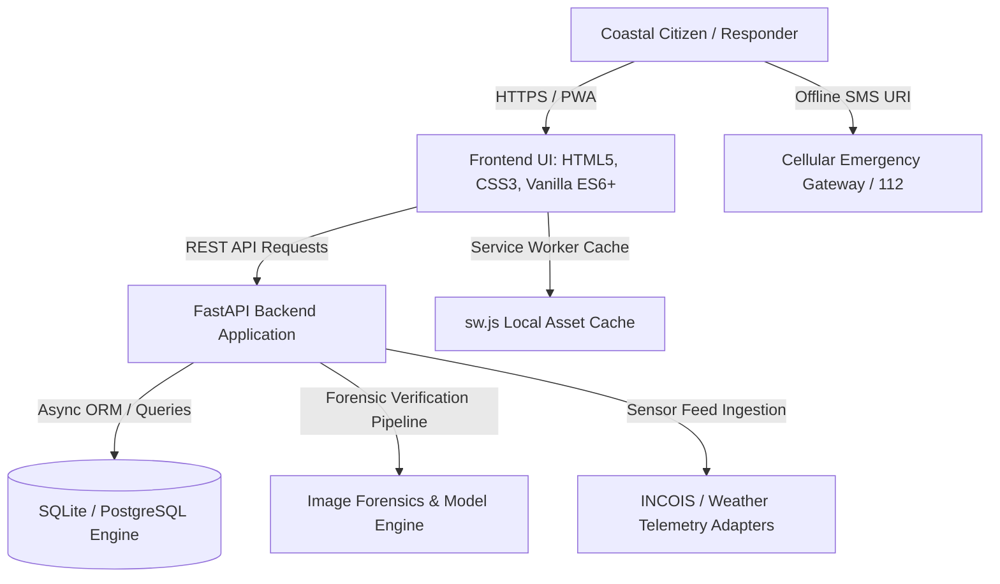

# AquaShield AI — Coastal Disaster Intelligence & Marine Safety Platform

AquaShield is an open-source coastal safety and disaster response platform designed for coastal residents, beachgoers, artisanal fishermen, and civil emergency volunteers. It pairs real-time oceanographic sensor telemetry with citizen hazard reporting, AI forensic image verification, safety-weighted evacuation routing, and offline SMS emergency protocols.

---

## Table of Contents

- [Project Specification & Architecture (Detailed Report)](docs/PROJECT_SPECIFICATION.md)
- [System Diagrams & Prompts (DFD, Flowchart, UML, Block Diagram)](docs/SYSTEM_DIAGRAMS_AND_PROMPTS.md)
- [Key Features](#key-features)
- [System Architecture](#system-architecture)
- [Tech Stack](#tech-stack)
- [Prerequisites](#prerequisites)
- [Quick Start](#quick-start)
  - [Option A: 1-Click Python Launcher (Recommended)](#option-a-1-click-python-launcher-recommended)
  - [Option B: Windows 1-Click Batch Script](#option-b-windows-1-click-batch-script)
  - [Option C: Manual Virtual Environment Setup](#option-c-manual-virtual-environment-setup)
- [Environment Configuration](#environment-configuration)
- [Core Workflows & Usage](#core-workflows--usage)
- [API Reference](#api-reference)
- [Repository Structure](#repository-structure)
- [Contributing & Standards](#contributing--standards)
- [License](#license)

---

## Key Features

1. **Real-Time Coastal Safety Telemetry**
   - Live monitoring of wave heights, wind velocity, barometric pressure, swell direction, and sea-surface temperature across key coastal sectors (e.g., Juhu, Girgaon Chowpatty, Aksa, Marine Drive).
   - Traffic-light safety index (Safe, Caution, Hazard) paired with telemetry data.

2. **Citizen Hazard Reporting & Forensic Verification**
   - Crowdsourced observation submission for storm surge, high tides, oil slicks, and coastal flooding.
   - Forensic image scanner designed to cross-reference timestamped observation imagery with sensor readings to mitigate outdated or synthetic reports.

3. **Safety-Weighted Evacuation Routing**
   - Route calculation engine utilizing risk-weighted shortest path algorithms to navigate away from inundated lowlands and flood zones toward verified relief shelters and medical hubs.

4. **Marine Wildlife Rescue Dispatch**
   - Rapid logging for stranded or injured marine fauna (sea turtles, cetaceans, marine avifauna) with automated dispatch routing to regional conservation NGOs.

5. **Offline PWA & Low-Bandwidth SMS Gateway**
   - Service Worker caching layer (`sw.js`) guarantees map availability and emergency checklists remain accessible when cell towers degrade.
   - Integrated `sms:` URI dispatch sends GPS coordinates directly to emergency response helplines (112, Coast Guard, NDMA) without cellular data.

6. **Interactive OpenAPI / Swagger Documentation**
   - Auto-generated interactive API explorer available at `/docs` with strict Pydantic schema validation across all endpoints.

---

## System Architecture



---

## Tech Stack

| Layer | Technologies |
|---|---|
| **Frontend** | HTML5, Vanilla CSS3 (Custom Design System), ES6+ JavaScript |
| **Mapping & GIS** | Leaflet.js, OpenStreetMap, SVG Radar Fallback Renderer |
| **Data Visualizations** | Chart.js 4.4, Native HTML5 Canvas Fallbacks |
| **Backend Framework** | Python 3.10+, FastAPI, Uvicorn (ASGI) |
| **Database & ORM** | Async SQLAlchemy 2.0, aiosqlite / asyncpg |
| **Validation & Settings** | Pydantic v2, Pydantic Settings |
| **Offline & PWA** | Web App Manifest, Service Worker Cache API, Geolocation API |

---

## Prerequisites

Before running AquaShield, ensure your local environment meets the following requirements:

- **Python**: Version `3.10` or higher (`python --version`)
- **Git**: Installed and configured (`git --version`)
- **Web Browser**: Modern Chromium, Firefox, or WebKit browser with JavaScript and Geolocation enabled

---

## Quick Start

### Option A: 1-Click Python Launcher (Recommended)

AquaShield includes an automated launcher script (`run_app.py`) that checks required packages, auto-installs any missing dependencies, initializes the local database, and launches your browser:

```bash
# 1. Clone the repository
git clone https://github.com/bash30ribs/AquaShield.git
cd AquaShield

# 2. Run the automated launcher
python run_app.py
```

The application will start on `http://127.0.0.1:8000` and open in your default browser.

---

### Option B: Windows 1-Click Batch Script

On Windows systems, execute the batch script directly from PowerShell or Command Prompt:

```cmd
START_AQUASHIELD.bat
```

---

### Option C: Manual Virtual Environment Setup

For standard developer workflow and backend customization:

```bash
# 1. Clone repository
git clone https://github.com/bash30ribs/AquaShield.git
cd AquaShield

# 2. Create and activate a Python virtual environment
python -m venv venv

# On Linux / macOS:
source venv/bin/activate

# On Windows (PowerShell):
.\venv\Scripts\Activate.ps1

# 3. Install backend dependencies
pip install --upgrade pip
pip install -r backend/requirements.txt

# 4. Start the FastAPI server with live reload
uvicorn backend.app.main:app --host 127.0.0.1 --port 8000 --reload
```

Access the application in your browser:
- **Web Platform**: `http://127.0.0.1:8000`
- **Interactive Swagger Docs**: `http://127.0.0.1:8000/docs`
- **ReDoc Documentation**: `http://127.0.0.1:8000/redoc`

---

## Environment Configuration

AquaShield operates out-of-the-box using local SQLite storage. For production or integration with external weather buoys and SMS gateways, configure environment variables:

1. Copy the example configuration file:
   ```bash
   cp backend/.env.example backend/.env
   ```
2. Adjust settings in `backend/.env` as needed:
   ```ini
   APP_NAME=AquaShield AI
   APP_VERSION=1.0.0
   DEBUG=True
   SECRET_KEY=your-secure-production-key-here
   DATABASE_URL=sqlite+aiosqlite:///./aquashield.db
   ```

---

## Core Workflows & Usage

### 1. Checking Beach & Sector Safety
- Navigate to the **Live Radar & Safety** view.
- Choose a sector (e.g., Juhu, Girgaon, Aksa) to review current swell height, wind vectors, and the composite safety badge (Safe, Caution, Hazard).

### 2. Submitting an Incident Observation
- Open the **Report Observation** module.
- Select the incident classification (e.g., High Tide Inundation, Cyclone Debris, Rip Current).
- Add observation coordinates (auto-populated via the browser's Geolocation API) and upload imagery.

### 3. Calculating Safe Evacuation Routes
- Access the **Evacuation Routes** screen.
- Provide your origin and designated refuge destination to generate a path that minimizes flood basin exposure.

### 4. Logging Injured Marine Life
- Access the **Marine Wildlife Rescue** screen.
- Select the animal category (Turtle, Marine Mammal, Seabird), log condition notes, and dispatch the alert to affiliated response teams.

### 5. Triggering Emergency SOS
- In severe network degradation, use the **Emergency SOS** action.
- When offline, AquaShield constructs a pre-formatted SMS emergency payload with GPS coordinates to trigger device-native messaging without data reception.

---

## API Reference

The backend provides RESTful endpoints organized under modular routers:

| Method | Endpoint | Description |
|---|---|---|
| `GET` | `/api/health` | Health-check endpoint reporting server status and version |
| `GET` | `/api/disasters` | Retrieve active disaster zones and hazard warnings |
| `POST` | `/api/reports` | Submit verified citizen hazard observation |
| `GET` | `/api/marine` | Fetch active marine animal rescue incidents |
| `POST` | `/api/marine` | Register new marine animal rescue case |
| `POST` | `/api/routes/calculate` | Compute safety-weighted evacuation routes |
| `POST` | `/api/sos/broadcast` | Dispatch emergency SOS alert |
| `POST` | `/api/chat` | Query disaster response SOP and protocol assistance |

Full parameter schemas and request/response models are accessible at `/docs`.

---

## Repository Structure

```
AquaShield/
├── docs/                    # Full project specification & system diagram prompts
│   ├── PROJECT_SPECIFICATION.md
│   └── SYSTEM_DIAGRAMS_AND_PROMPTS.md
├── index.html               # Main SPA entry point and interface structure
├── style.css                # CSS design system and responsive layout tokens
├── app.js                   # Client-side state, Leaflet GIS integration, and fallback engines
├── sw.js                    # PWA Service Worker for offline asset caching
├── manifest.json            # Web App Manifest for mobile installation
├── run_app.py               # Automated launcher and environment validator
├── START_AQUASHIELD.bat     # Windows 1-click startup batch script
├── robots.txt               # Crawler directives and search index governance
├── sitemap.xml              # Search engine canonical URL map
├── STANDARDS.md             # Codebase design system, typography, and architectural rules
├── AGENTS.md                # Development integrity and engineering standards
├── dataset/                 # Model evaluation and training datasets
├── train_forensics.py       # Training pipeline for image forensics validation
└── backend/
    ├── requirements.txt     # Python backend dependencies
    ├── .env.example         # Template environment configuration
    └── app/
        ├── main.py          # FastAPI application initialization & middleware
        ├── config.py        # Configuration loading and environment management
        ├── database.py      # Async SQLAlchemy engine and session factory
        ├── models/          # ORM data models
        ├── schemas/         # Pydantic request/response schemas
        ├── services/        # Business logic, risk calculations, and forensic tools
        └── routers/         # REST API route handlers
```

---

## Contributing & Standards

1. **Adhere to [STANDARDS.md](STANDARDS.md)**:
   - Use the domain palette (`#07111e`, `#0c1827`, `#f59e0b`, `#10b981`, `#ef4444`).
   - Use the standardized 8px layout grid and defined typography scale (`Outfit` + `Inter`).
2. **Follow [AGENTS.md](AGENTS.md)**:
   - Ensure genuine functionality with zero artificial metrics or placeholder data.
   - Maintain strict WCAG AA accessibility contrast ratios.
3. **Submitting Changes**:
   ```bash
   git checkout -b feature/your-feature-name
   # Make changes and test locally via python run_app.py
   git commit -m "feat: describe your change cleanly"
   git push origin feature/your-feature-name
   ```

---

## License

This project is licensed under the MIT License. See the [LICENSE](LICENSE) file for full details.
