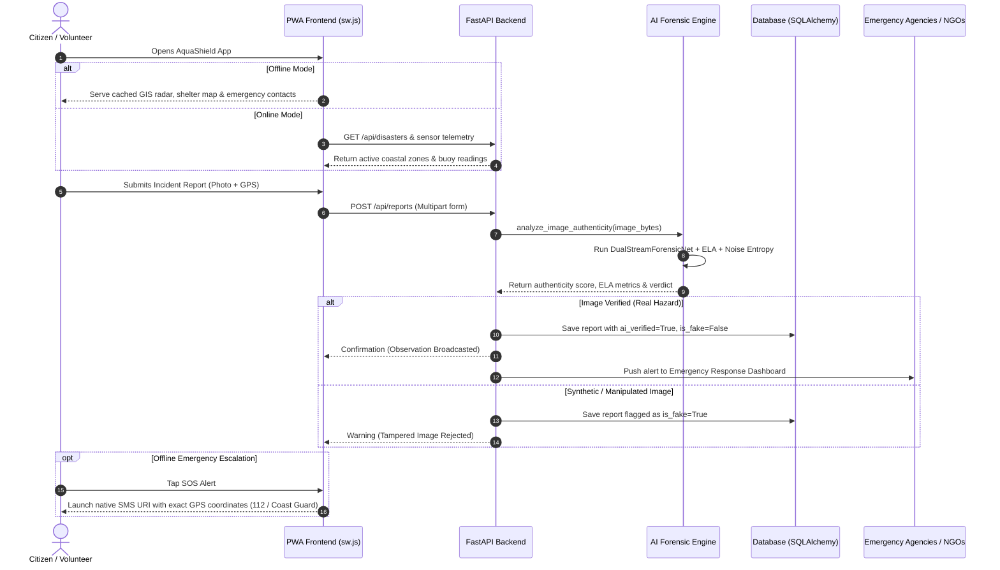

# AquaShield AI — Comprehensive Project Specification & Technical Report

## 1. Project Idea & Executive Summary (प्रोजेक्ट का पूरा आइडिया)

**AquaShield AI** is an intelligent, dual-resilience coastal disaster intelligence and marine safety platform. It bridges the critical operational gap between complex oceanographic sensor telemetry, emergency disaster management agencies (e.g., NDMA, Indian Coast Guard, State Disaster Management Authorities), and coastal citizens (fishermen, daily beachgoers, civil defense volunteers).

### Core Problem Solved:
1. **Sensor Disconnect**: Government ocean buoys and weather radars produce high-precision telemetry, but the data is rarely translated into actionable, real-time safety advisories for citizens on the ground.
2. **False Panic & Synthetic Disaster Misinformation**: During extreme cyclones and flash floods, social media is overwhelmed by AI-generated images, synthetic flood photos, and recycled footage from past disasters, causing civilian panic and misallocating rescue forces.
3. **Network Collapse During Catastrophes**: Cellular data towers and Wi-Fi networks frequently fail during severe tsunamis and storm surges, rendering cloud-dependent emergency apps inoperable.
4. **Neglected Marine Wildlife**: Oil spills and high-energy storm surges leave injured and stranded marine fauna (sea turtles, cetaceans, marine avifauna) without a centralized emergency response pipeline.

### The AquaShield Solution:
AquaShield provides an **offline-first Progressive Web Application (PWA)** integrated with a **FastAPI backend**, an **AI Forensic Dual-Stream Verification Engine** (EfficientNet-B0 + Error Level Analysis), **risk-weighted evacuation routing algorithms**, and a **low-bandwidth SMS emergency gateway** that requires zero active internet access.

---

## 2. Overview & Scope (प्रोजेक्ट का ओवरव्यू)

AquaShield operates across three interconnected operational domains:
- **Civilian Safety & Beachgoers**: Real-time traffic-light beach safety ratings (Safe, Caution, Hazard), wave height monitors, rip current alerts, and emergency first-aid SOP guides.
- **Disaster Response & First Responders**: Evacuation corridor routing away from flood-prone lowlands, real-time verified citizen incident feed, and SOS alert dispatching.
- **Environmental & Marine Conservation**: Specialized reporting modules for marine wildlife strandings with automatic telemetry tagging and direct NGO notification.

---

## 3. Methodology (प्रोजेक्ट की कार्यप्रणाली / मेथडोलॉजी)

AquaShield utilizes a five-phase technical methodology:

```
[Phase 1: Sensor & Telemetry Ingestion]
                │
                ▼
[Phase 2: Citizen Incident Ingestion]
                │
                ▼
[Phase 3: Multi-Layer AI Forensic Verification Pipeline]
                │
                ▼
[Phase 4: Risk-Weighted Evacuation Routing & Analysis]
                │
                ▼
[Phase 5: Resilient Multi-Channel Emergency Dispatch (Web, PWA, SMS)]
```

### Phase 1: Sensor & Telemetry Ingestion
- Real-time ingestion of coastal meteorological parameters: swell height (m), wave period (s), wind velocity (km/h), surface air temperature, and atmospheric pressure.
- Normalization against oceanographic threshold tables to generate a composite Coastal Hazard Index (CHI).

### Phase 2: Citizen Incident Ingestion
- Geolocation API extracts coordinate pairs (`latitude`, `longitude`) along with device timestamp.
- User selects hazard classification: Storm Surge, High Tide Inundation, Coastal Erosion, Oil Spill, Marine Life Stranding, or Infrastructure Debris.

### Phase 3: Multi-Layer AI Forensic Verification Pipeline
To prevent fake reports from triggering emergency dispatch, uploaded imagery passes through a 6-stage pipeline:
1. **PyTorch Dual-Stream Neural Network (`DualStreamForensicNet`)**:
   - Stream A: EfficientNet-B0 evaluates raw RGB visual features.
   - Stream B: EfficientNet-B0 evaluates Error Level Analysis (ELA) compression gradients.
   - Merged Dense Classifier predicts image authenticity probability.
2. **2D Artwork / Synthetic Rendering Detection**: Detects vector illustrations, anime, and cartoon renders using color histogram variance and edge thresholding.
3. **EXIF Metadata & Hardware Camera Inspection**: Verifies camera make, focal length, exposure, and software alteration tags.
4. **Error Level Analysis (ELA)**: Resaves at 90% JPEG quality, computes differential pixel error, and identifies localized digital tampering or image splicing.
5. **Frequency Domain Noise & High-Frequency Texture Entropy**: Analyzes Laplacian noise consistency across pixel regions.
6. **Hydro-Hazard Spectral Analysis**: Analyzes hue, saturation, and water-sheen spectra to confirm genuine fluid/oil/flood signatures.

### Phase 4: Risk-Weighted Evacuation Routing
- Computes safe corridors from hazardous shoreline coordinates to designated relief shelters.
- Employs a modified risk-weighted shortest path algorithm that penalizes segments passing through low-elevation terrain or active inundation zones.

### Phase 5: Resilient Multi-Channel Dispatch
- **Online**: Asynchronous REST API updates SQLite/PostgreSQL, notifying emergency dashboards.
- **Offline PWA**: Service Worker (`sw.js`) intercepts network requests and serves cached radar maps, contact lists, and SOPs.
- **Zero-Data Fallback**: Generates structured `sms:` URI payloads transmitting latitude, longitude, and hazard severity directly to Coast Guard (1554) and National Emergency (112) helplines.

---

## 4. System Architecture (सिस्टम आर्किटेक्चर)

AquaShield follows a modern, decoupled **3-Tier Architecture**:

```
┌────────────────────────────────────────────────────────────────────────┐
│                   TIER 1: PRESENTATION & CLIENT LAYER                   │
│                                                                        │
│   ┌─────────────────────┐   ┌──────────────────┐   ┌───────────────┐   │
│   │   HTML5 / CSS3 SPA  │   │  Leaflet.js GIS  │   │   Chart.js    │   │
│   │   (Glassmorphism)   │   │   & SVG Radar    │   │   Telemetry   │   │
│   └──────────┬──────────┘   └────────┬─────────┘   └───────┬───────┘   │
│              │                       │                     │           │
│   ┌──────────┴───────────────────────┴─────────────────────┴───────┐   │
│   │       Service Worker (sw.js) Cache & Offline Manifest API      │   │
│   └──────────────────────────────────┬─────────────────────────────┘   │
└──────────────────────────────────────┼─────────────────────────────────┘
                                       │ HTTPS / JSON / FormData
┌──────────────────────────────────────┼─────────────────────────────────┐
│               TIER 2: APPLICATION & AI BACKEND LAYER                    │
│                                      ▼                                 │
│   ┌────────────────────────────────────────────────────────────────┐   │
│   │                    FastAPI ASGI Application                    │   │
│   │            (CORS, Security Middleware, Lifespan DB)            │   │
│   └──────┬────────────┬─────────────┬────────────┬───────────┬─────┘   │
│          │            │             │            │           │         │
│          ▼            ▼             ▼            ▼           ▼         │
│     [Disasters]   [Reports]     [Marine]      [Routes]     [Chat]      │
│       Router       Router        Router        Router      Router      │
│                       │                                      │         │
│                       ▼                                      ▼         │
│           ┌───────────────────────┐            ┌───────────────────┐   │
│           │   AI Forensic Service │            │  Coastal Copilot  │   │
│           │ (Dual-Stream Net/ELA) │            │ (RAG & SOP Engine)│   │
│           └───────────────────────┘            └───────────────────┘   │
└──────────────────────────────────────┬─────────────────────────────────┘
                                       │ Async SQLAlchemy 2.0
┌──────────────────────────────────────┼─────────────────────────────────┐
│                     TIER 3: DATA & STORAGE LAYER                        │
│                                      ▼                                 │
│   ┌───────────────────────┐                    ┌───────────────────┐   │
│   │  SQLite / PostgreSQL  │                    │ File System Store │   │
│   │  (Disasters, Reports, │                    │ (Forensic Scans & │   │
│   │   Rescues, Users)     │                    │  Incident Images) │   │
│   └───────────────────────┘                    └───────────────────┘   │
└────────────────────────────────────────────────────────────────────────┘
```

---

## 5. System Workflow (सिस्टम वर्कफ़्लो)



---

## 6. Features & Detailed Module Breakdown (फीचर्स का विवरण)

| Module | Purpose | Core Technologies | Primary Endpoints |
|---|---|---|---|
| **Live Safety Radar** | Real-time swell, wave height, and coastal status | HTML5 Canvas, SVG Radar, Chart.js 4.4 | `GET /api/disasters` |
| **Forensic Hazard Ingest** | Citizen hazard reporting with fake-photo filtering | PyTorch, EfficientNet-B0, PIL, ELA, OpenCV | `POST /api/reports` |
| **Evacuation Navigator** | Elevation & risk-weighted path calculation | Dijkstra / A* variant, Leaflet GIS | `POST /api/routes/calculate` |
| **Marine Wildlife Rescue** | Stranded marine life reporting & dispatch | SQLAlchemy Async ORM, GPS coordinate locator | `GET/POST /api/marine` |
| **Offline PWA Engine** | Local asset caching during network blackouts | Service Worker Cache API, Web Manifest | `sw.js`, `manifest.json` |
| **SMS Emergency SOS** | Zero-data emergency alert dispatch | Standard `sms:` URI protocol | `POST /api/sos/broadcast` |
| **Disaster Copilot** | Interactive SOP assistant for cyclones & first aid | Context-aware Rule/RAG Matcher, SQLite | `POST /api/chat` |
| **Mesh Broadcast** | Local emergency alert propagation | Peer-to-peer WebRTC & localStorage fallback | `mesh_broadcast.js` |

---

## 7. Security, Offline Resilience & Reliability

1. **Security Headers**: Custom ASGI middleware injects `X-Content-Type-Options: nosniff`, `X-Frame-Options: SAMEORIGIN`, and strict `Permissions-Policy: geolocation=(self)`.
2. **Input Validation**: Strict Pydantic v2 validation models ensure SQL injection and malicious payloads are rejected at the router level.
3. **Graceful Fallbacks**:
   - Leaflet map failure triggers an integrated SVG Radar visualization.
   - Backend unavailability triggers localized mock sensor telemetry in the frontend.
   - Network failure triggers native SMS emergency routing.

---

## 8. Technology Stack & Environment

- **Frontend**: Vanilla ES6+ JavaScript, CSS Custom Properties (Obsidian Midnight Navy `#07111e`, Distress Amber `#f59e0b`), HTML5.
- **Backend**: Python 3.10+, FastAPI 0.115, Uvicorn 0.30, SQLAlchemy 2.0 (Async), Pydantic 2.9.
- **Deep Learning / Vision**: PyTorch, Torchvision, Pillow (PIL), NumPy, EfficientNet-B0.
- **Database**: SQLite (via `aiosqlite`) for zero-configuration standalone operation, switchable to PostgreSQL (via `asyncpg`) for enterprise deployment.
