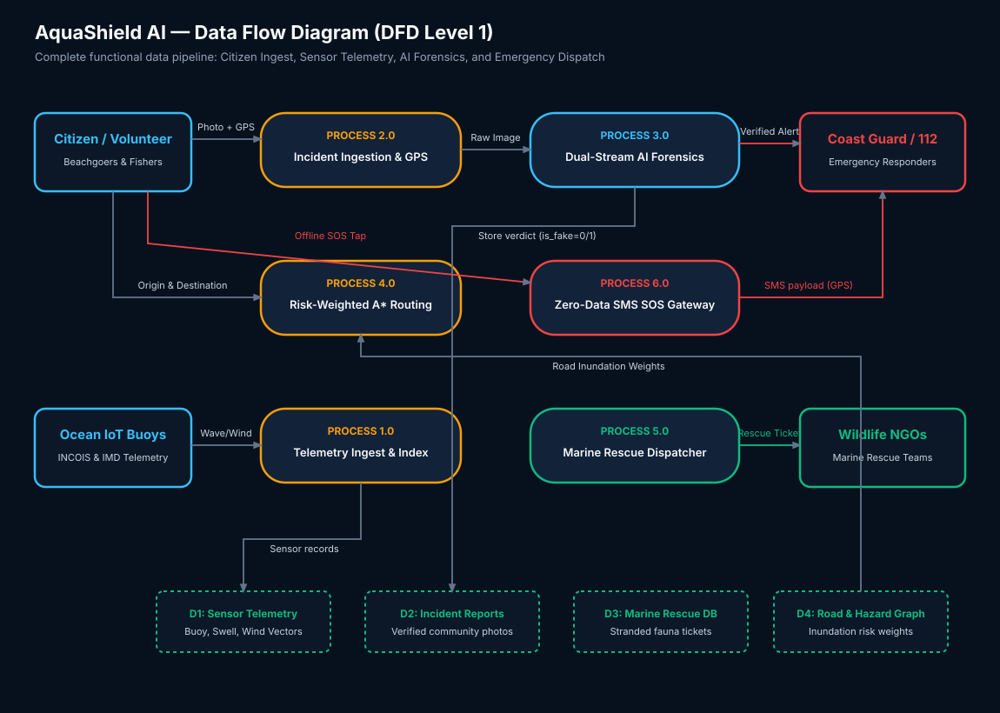
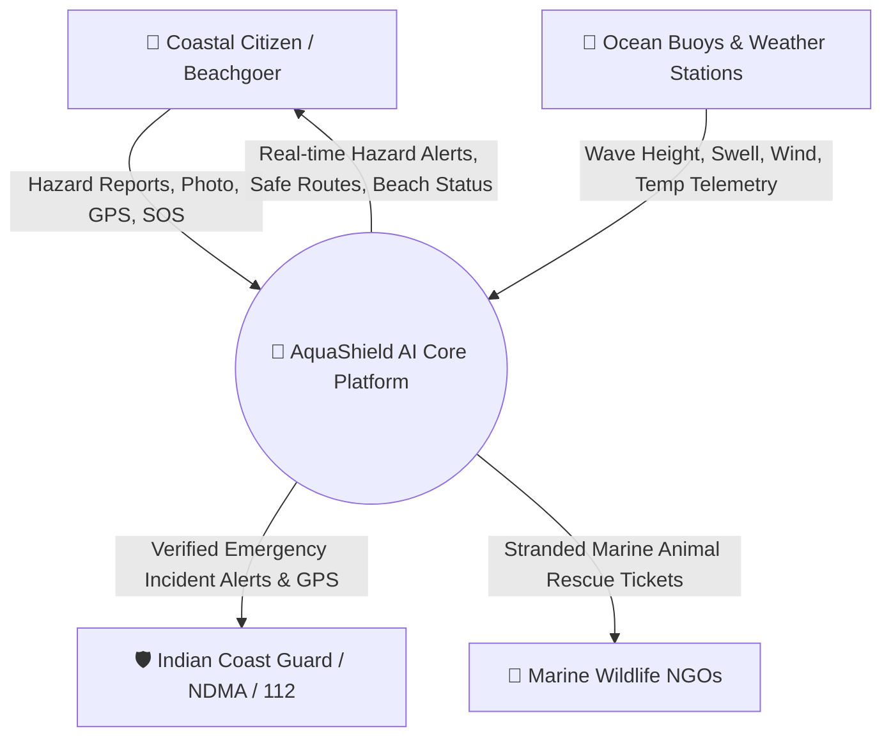
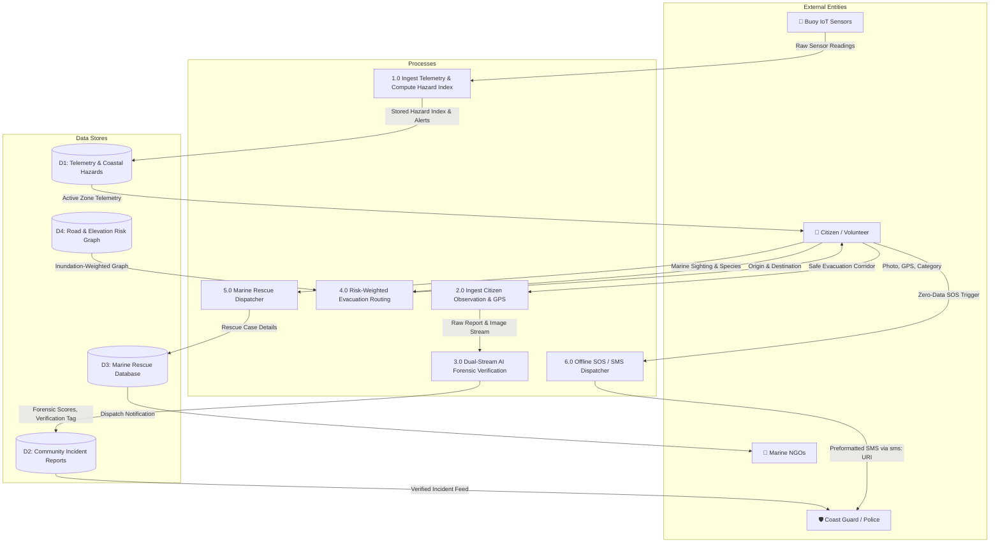
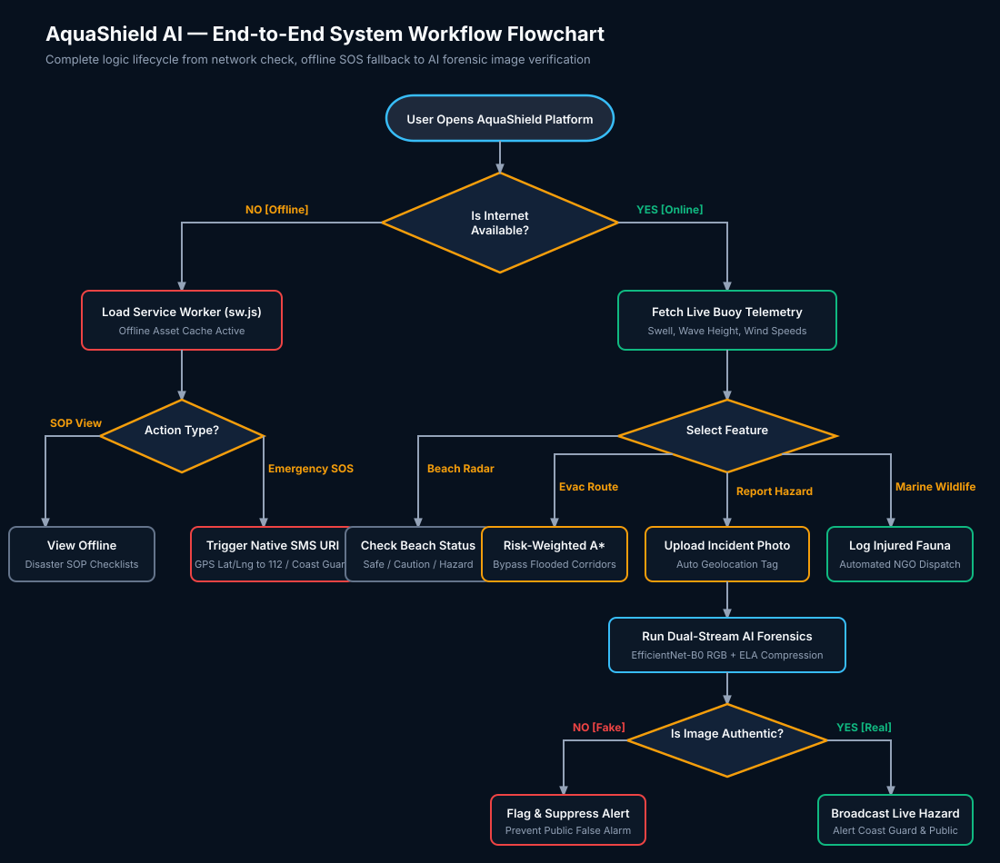
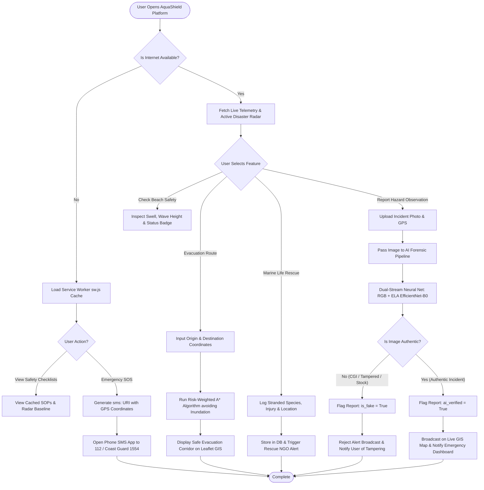
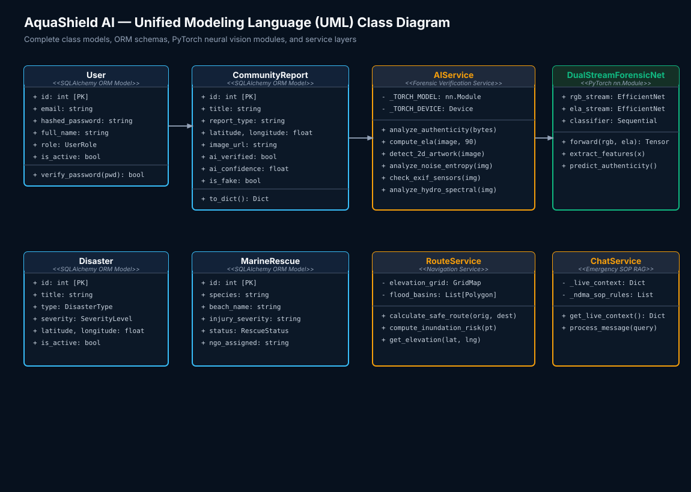
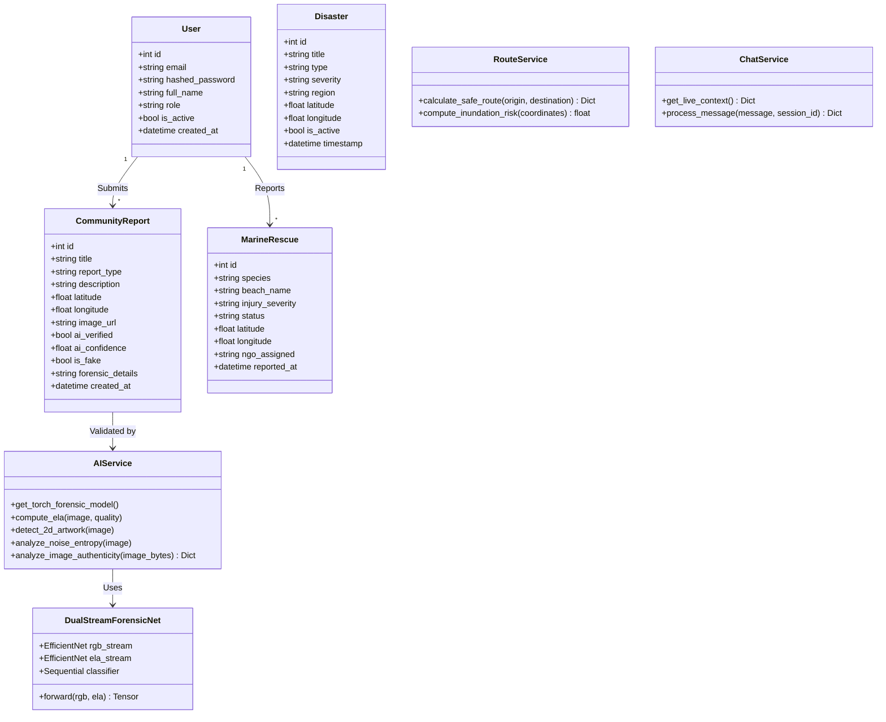
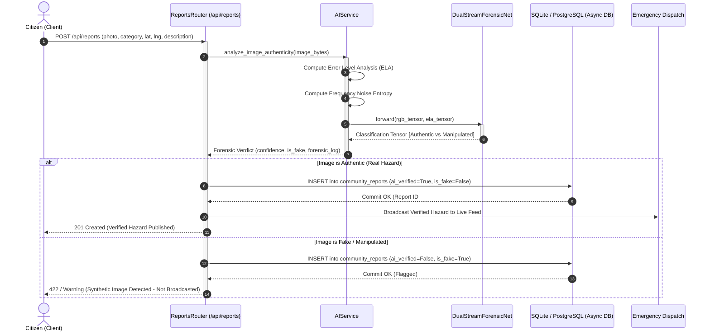
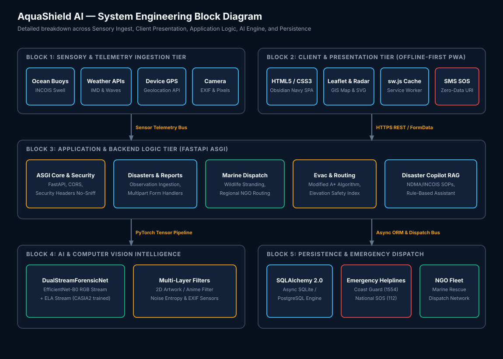
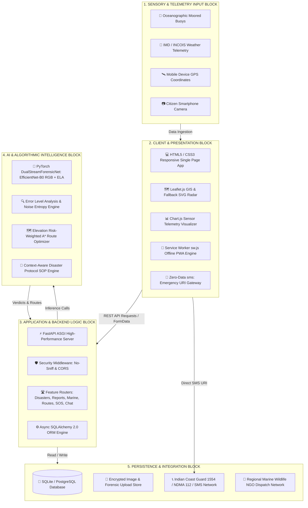

# AquaShield AI — System Diagrams & Generator Prompts

This document contains GitHub-renderable Mermaid diagrams alongside ready-to-use prompt templates for **Data Flow Diagrams (DFD)**, **System Flowcharts**, **UML Diagrams**, and **Block Diagrams**.

---

## 1. Data Flow Diagram (DFD)

### Visual Vector Diagram (SVG)

*Direct SVG File*: [`docs/diagrams/dfd_diagram.svg`](diagrams/dfd_diagram.svg)

### 1.1 Level 0: Context Level Diagram (GitHub Rendered)



### 1.2 Level 1: Subsystem Data Flow Diagram (GitHub Rendered)



---

### 1.3 Ready-to-Use Prompt: Data Flow Diagram (DFD)

> **Copy and paste this prompt into ChatGPT, Claude, Eraser.io, or Lucidchart:**
>
> ```text
> Create a comprehensive Level 0 and Level 1 Data Flow Diagram (DFD) for "AquaShield AI", an AI-powered coastal disaster intelligence and marine safety platform.
> 
> System Context:
> - External Entities:
>   1. Coastal Citizens / Beachgoers / Volunteers
>   2. Oceanographic Buoy IoT Sensors & Meteorological Services (INCOIS, IMD)
>   3. Emergency Response Agencies (Indian Coast Guard, NDMA, Police 112)
>   4. Marine Wildlife Rescue NGOs
> 
> - Level 1 Processes:
>   - Process 1.0: Ocean Sensor Telemetry Ingestion & Hazard Calculation (computes wave/swell risk index).
>   - Process 2.0: Citizen Incident Observation Capture (collects photo, GPS, category).
>   - Process 3.0: Dual-Stream AI Forensic Verification (runs EfficientNet-B0 + Error Level Analysis to detect fake/tampered photos).
>   - Process 4.0: Risk-Weighted Evacuation Route Optimization (computes shortest path penalizing flood zones).
>   - Process 5.0: Marine Wildlife Rescue Dispatcher (coordinates species stranding alerts with NGOs).
>   - Process 6.0: Offline Emergency SOS & SMS Transmission (constructs zero-data SMS packets).
> 
> - Data Stores:
>   - D1: Ocean Telemetry & Coastal Hazard Store
>   - D2: Community Incident Reports & Forensic Verifications
>   - D3: Marine Wildlife Rescue Registry
>   - D4: Coastal Elevation & Road Inundation Graph
> 
> Please output standard Gane & Sarson or Yourdon DFD notation with clear directional data flow labels, processes, data stores, and external entities.
> ```

---

## 2. System Workflow Flowchart

### Visual Vector Diagram (SVG)

*Direct SVG File*: [`docs/diagrams/flowchart_diagram.svg`](diagrams/flowchart_diagram.svg)

### 2.1 End-to-End Decision Flowchart (GitHub Rendered)



---

### 2.2 Ready-to-Use Prompt: Flowchart

> **Copy and paste this prompt into ChatGPT, Claude, Eraser.io, or Whimsical:**
>
> ```text
> Create an end-to-end user and system logic flowchart for "AquaShield AI", a coastal disaster management and incident response system.
> 
> Flow Requirements:
> 1. Start: User opens the application.
> 2. Decision node: "Is Internet Available?".
>    - If NO (Offline Path):
>      - Service Worker activates local asset cache.
>      - User can view offline disaster survival checklists.
>      - If User triggers Emergency SOS: App generates a pre-populated SMS payload with GPS coordinates and opens the device's native SMS composer directed to Coast Guard (1554) or 112 without data.
>    - If YES (Online Path):
>      - Loads live ocean buoy telemetry (wave height, swell, wind).
>      - User chooses between:
>        A. Check Beach Safety (Juhu, Girgaon, Aksa) -> Displays green/yellow/red status.
>        B. Evacuation Navigation -> Runs safety-weighted A* algorithm avoiding flood zones.
>        C. Marine Wildlife Rescue -> Submits stranded animal ticket and notifies NGOs.
>        D. Report Hazard Observation -> User uploads photo and GPS.
> 3. Forensic Decision Gate for Hazard Photos:
>    - Image passes to Dual-Stream Neural Network (EfficientNet-B0 RGB + ELA) + Noise Entropy.
>    - Decision: "Is Image Authentic?".
>      - If NO: Mark as fake/tampered, reject public broadcast, display warning.
>      - If YES: Mark as verified, commit to database, display on live GIS map, and push alert to responders.
> 4. End State.
> 
> Format as a clean, professional flowchart using standard ISO flowchart symbols (terminators, process rectangles, decision diamonds, and labeled branches).
> ```

---

## 3. Unified Modeling Language (UML) Diagrams

### Visual Vector Diagram (SVG)

*Direct SVG File*: [`docs/diagrams/uml_class_diagram.svg`](diagrams/uml_class_diagram.svg)

### 3.1 UML Class Diagram (GitHub Rendered)



### 3.2 UML Sequence Diagram: Incident Submission & Verification (GitHub Rendered)



---

### 3.3 Ready-to-Use Prompt: UML Diagrams

> **Copy and paste this prompt into ChatGPT, Claude, PlantUML, or Visual Paradigm:**
>
> ```text
> Generate professional UML diagrams (Class Diagram and Sequence Diagram) for "AquaShield AI", a coastal emergency management platform.
> 
> 1. UML Class Diagram Details:
>    - Entities / Data Models:
>      - User (id, email, password, role, is_active, created_at)
>      - Disaster (id, title, type, severity, region, latitude, longitude, is_active)
>      - CommunityReport (id, title, report_type, latitude, longitude, image_url, ai_verified, ai_confidence, is_fake, forensic_details)
>      - MarineRescue (id, species, beach_name, injury_severity, status, ngo_assigned)
>    - Service Classes:
>      - AIService: contains analyze_image_authenticity(), compute_ela(), detect_2d_artwork(), analyze_noise_entropy().
>      - DualStreamForensicNet (inherits from PyTorch nn.Module): contains rgb_stream (EfficientNet-B0), ela_stream (EfficientNet-B0), classifier head, forward(rgb, ela).
>      - RouteService: contains calculate_safe_route(), compute_inundation_risk().
>      - ChatService: contains get_live_context(), process_message().
>    - Relationships: Show associations between User and CommunityReport, CommunityReport and AIService, and AIService and DualStreamForensicNet.
> 
> 2. UML Sequence Diagram Details:
>    - Actors/Lifelines: Citizen Client -> FastAPI ReportsRouter -> AIService -> DualStreamForensicNet -> Async Database -> Emergency Notification Dispatch.
>    - Action: User submits a multipart photo hazard report. Model runs dual-stream RGB + ELA inference. Branches on authentic vs fake result. Authentic commit triggers emergency broadcast; fake commit flags report and rejects alert.
> 
> Format in standard PlantUML syntax or high-resolution vector layout.
> ```

---

## 4. System Block Diagram

### Visual Vector Diagram (SVG)

*Direct SVG File*: [`docs/diagrams/system_block_diagram.svg`](diagrams/system_block_diagram.svg)

### 4.1 System Block Architecture (GitHub Rendered)



---

### 4.2 Ready-to-Use Prompt: Block Diagram

> **Copy and paste this prompt into ChatGPT, Claude, Eraser.io, or Draw.io:**
>
> ```text
> Create an engineering Block Diagram for "AquaShield AI", an AI-powered Coastal Disaster Intelligence and Marine Safety Platform.
> 
> Organize the diagram into 5 distinct, well-labeled functional hardware and software blocks:
> 
> 1. Sensory & Telemetry Ingestion Block:
>    - Oceanographic Buoy IoT Sensors (INCOIS, NDBC)
>    - Meteorological API feeds (IMD, OpenWeather)
>    - Device Hardware Sensors (GPS Geolocation, Camera Sensor)
> 
> 2. Client & Presentation Block (Offline-First Frontend):
>    - Water-Themed HTML5 / Vanilla CSS3 SPA Interface
>    - Leaflet GIS Mapping Engine & Offline SVG Radar Fallback
>    - Chart.js 4.4 Oceanographic Telemetry Visualizer
>    - Service Worker (sw.js) Cache & Web App Manifest
>    - Native `sms:` URI Emergency Gateway
> 
> 3. Application & Backend Logic Block:
>    - FastAPI ASGI High-Performance Application Server
>    - Security Headers Middleware & CORS Handlers
>    - RESTful Feature Routers (Disasters, Reports, Marine, Routes, SOS, Chat)
>    - Async SQLAlchemy 2.0 ORM Controller
> 
> 4. AI & Algorithmic Processing Block:
>    - PyTorch DualStreamForensicNet (RGB EfficientNet-B0 + ELA Stream)
>    - Error Level Analysis (ELA) and Noise Entropy Filter
>    - Risk-Weighted Evacuation Routing Engine (Dijkstra / A*)
>    - Emergency Protocol RAG & SOP Knowledge Engine
> 
> 5. Persistence & External Dispatch Block:
>    - SQLite / PostgreSQL Database
>    - Local File System Storage for Uploaded Incident Scans
>    - Emergency Dispatch Interconnect (Indian Coast Guard 1554, NDMA, 112 SMS)
>    - Marine Wildlife Conservation NGO Dispatch Network
> 
> Show directional data bus and communication arrows between blocks indicating protocols (HTTPS, REST, ORM queries, SMS URI).
> ```
